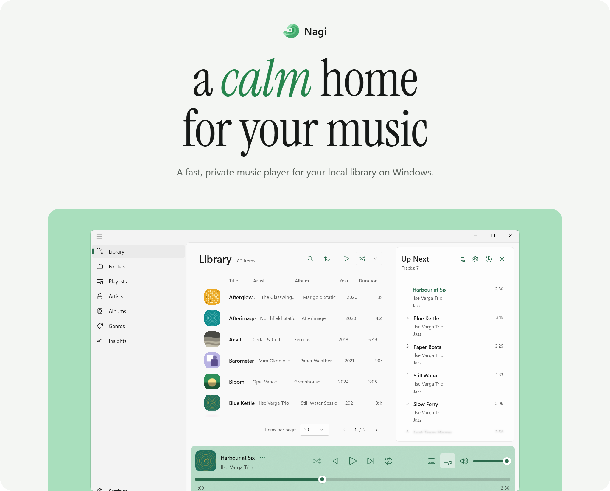
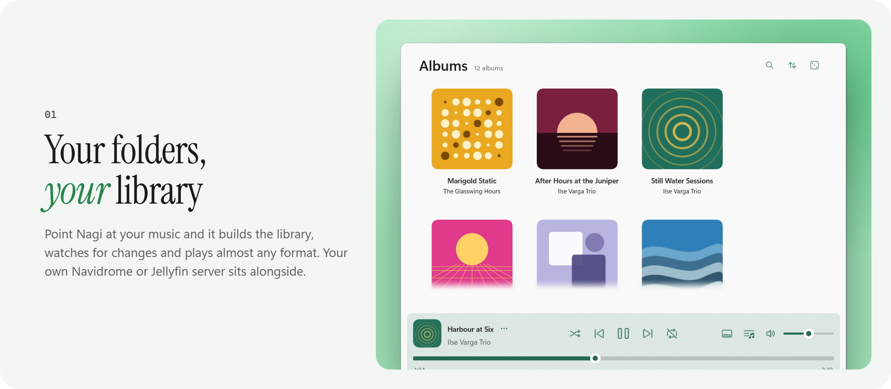
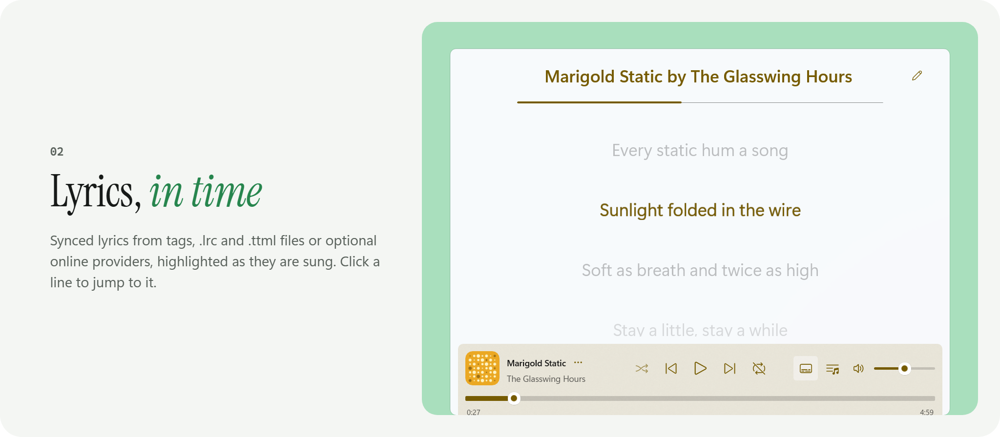
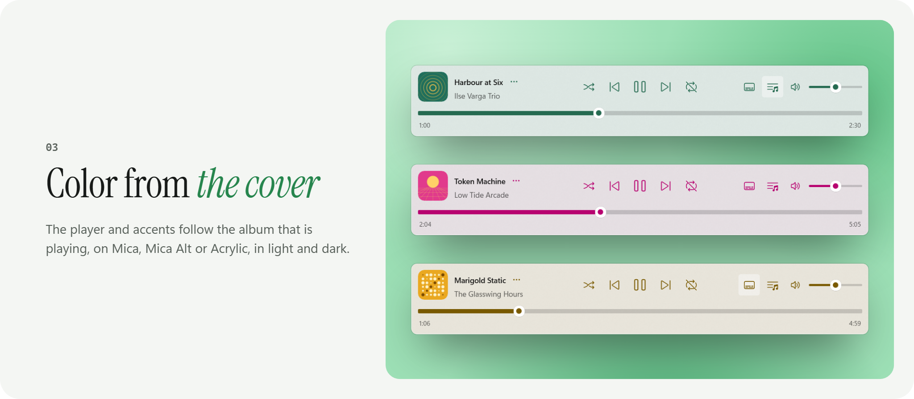
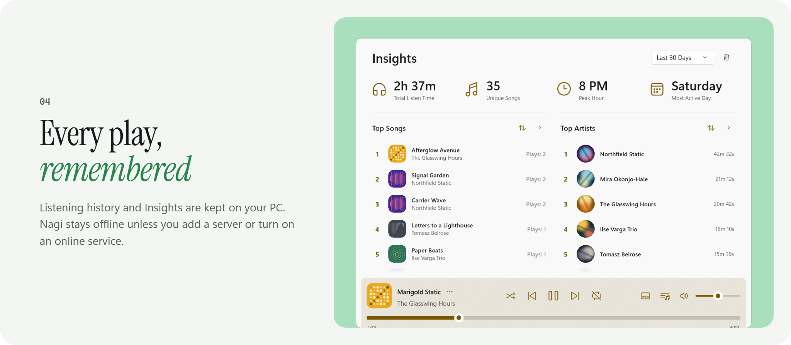

<picture>
  <source media="(prefers-color-scheme: dark)" srcset=".github/readme/hero-dark.png">
  
</picture>

<div align="center">

<p>
  <a href="https://github.com/Anthonyy232/Nagi/releases/latest"></a>
  <a href="https://github.com/Anthonyy232/Nagi/releases"></a>
  <a href="https://github.com/Anthonyy232/Nagi/actions/workflows/build.yml"></a>
  <a href="https://crowdin.com/project/nagi"></a>
  <a href="https://github.com/Anthonyy232/Nagi/blob/master/LICENSE"></a>
</p>

</div>

<div align="center">
  <a href="https://apps.microsoft.com/detail/9P1V1PPML3QT?referrer=appbadge&launch=true&mode=full"></a>
  &nbsp;
  <a href="https://github.com/Anthonyy232/Nagi/releases/latest"></a>
</div>

<br>

Windows 10 (1809 or later) or Windows 11, on x64 or ARM64. The Store version updates through the Store. From GitHub, install `Nagi.appinstaller` from the latest release so it updates itself. More on the [website](https://anthonyy232.github.io/Nagi/).

Nagi plays the music already on your computer, and can stream from your own Navidrome or Jellyfin server. Point it at your folders and it builds and maintains the library, plays almost any format through LibVLC, and stays offline unless you add a server or turn on an online service. The [privacy policy](PRIVACY.md) lists what each service sends.

## Using Nagi

On first launch Nagi asks where your music is: add one or more folders and it scans them into the library. Add or remove folders later, or add a Navidrome or Jellyfin server, on the Folders page.

Browse by songs, folders, playlists, artists, albums or genres, and open Up Next from the player to see and reorder the queue. Right-click a song for more actions.

Settings is grouped into:

- **Appearance**: theme, language, window backdrop, colors from album art, song list columns, and which pages the navigation shows.
- **Player Management**: volume normalization, WASAPI exclusive output and the output device, fades, and how Nagi starts, minimizes and hides to the tray.
- **Data Management**: how artist and genre tags are split, online metadata and lyrics sources, romanization packs, playlist import and export, and backup and restore.
- **Integrations**: Last.fm, ListenBrainz and Discord Rich Presence.

## Features

<picture>
  <source media="(prefers-color-scheme: dark)" srcset=".github/readme/feature-library-dark.png">
  
</picture>

**Library**

- Folder-based library that rescans automatically when files change.
- Streaming from your own Navidrome or other OpenSubsonic server, or Jellyfin 10.11 and later, alongside your local music. Favorites and play counts sync both ways, the server's playlists show up read-only next to yours, and lyrics stored on the server are used first.
- MP3, FLAC, AAC, OGG, WAV, AIFF, APE, DSD, M4A, WMA, WavPack and more.
- Playlists, rule-based smart playlists, and M3U import and export.
- Favorites (Ctrl+D), stored in Nagi's database without touching your files.
- Searchable listening history and an Insights page.
- Choose which columns song lists show, such as BPM, plays or date added, and open Song Info for a track's tags and file details.

**Playback**

- Up Next pane with reordering, shuffle and repeat. Drop files or folders on the player to queue them without importing.
- Listening mixes: **More Variety** spaces out artists and skips recent plays, **Rediscover** picks songs not heard in 30 days, **Unheard** plays songs you've never played.
- **Play for…** builds a queue that fits a chosen duration.
- Sleep timer: after the current song, at the end of the queue, or after a set time.
- 10-band equalizer with preamp, ReplayGain normalization measured locally, and 0.5× to 2× speed without pitch change.

<picture>
  <source media="(prefers-color-scheme: dark)" srcset=".github/readme/feature-lyrics-dark.png">
  
</picture>

<picture>
  <source media="(prefers-color-scheme: dark)" srcset=".github/readme/feature-color-dark.png">
  
</picture>

**Lyrics and appearance**

- Lyrics from embedded tags, `.lrc` and `.ttml` files, or optional online providers, highlighted word by word when the lyrics time each word. Click a synced line to seek to it.
- Local romanization for Japanese, Korean and Hindi lyrics via downloadable packs.
- Mica, Mica Alt and Acrylic backdrops, with colors taken from the current album art.
- Resizable always-on-top mini-player.

**Windows integration**

- Tray popup, media keys, system media controls and taskbar thumbnail buttons.
- Jump list entries to shuffle the library or open the mini-player.

<picture>
  <source media="(prefers-color-scheme: dark)" srcset=".github/readme/feature-insights-dark.png">
  
</picture>

**Optional online services** (off by default)

- Last.fm and ListenBrainz scrobbling, with an offline queue.
- Discord Rich Presence.
- Artist images, biographies and album covers from MusicBrainz, Wikipedia, Cover Art Archive, fanart.tv, TheAudioDB, Deezer, Apple Music and Last.fm.
- Lyrics from LRCLIB and NetEase.

## Built with

[.NET 11](https://dotnet.microsoft.com/), [WinUI 3](https://learn.microsoft.com/windows/apps/winui/winui3/), [LibVLCSharp](https://github.com/videolan/libvlcsharp), [EF Core](https://learn.microsoft.com/ef/core/) with SQLite, [ATL](https://github.com/Zeugma440/atldotnet), [libebur128](https://github.com/jiixyj/libebur128), [ModernLrc](https://github.com/Anthonyy232/ModernLrcParser), [ImageSharp](https://github.com/SixLabors/ImageSharp), [Material Color Utilities](https://github.com/albi005/MaterialColorUtilities), [Windows Community Toolkit](https://github.com/CommunityToolkit/Windows), [H.NotifyIcon](https://github.com/HavenDV/H.NotifyIcon) and [Serilog](https://serilog.net/).

## Build from source

You need Visual Studio 2026 or later with the **.NET Desktop Development** and **Universal Windows Platform development** workloads, and the .NET 11 SDK.

```bash
git clone https://github.com/Anthonyy232/Nagi.git
```

Open `Nagi.sln`, set the platform to `x64` or `ARM64`, and run **Nagi (Package)**. To build and test from a terminal:

```bash
dotnet build Nagi.sln -c Debug -p:Platform=x64
dotnet test --solution Nagi.sln -p:Platform=x64 --no-build
```

Some tests need `ffmpeg` on `PATH`.

## Contributing

Issues and pull requests are welcome. Read [AGENTS.md](AGENTS.md) before opening a pull request. Translations are handled on [Crowdin](https://crowdin.com/project/nagi) and need no code changes.

If you'd like to support development, you can [sponsor on GitHub](https://github.com/sponsors/Anthonyy232).

## License

Copyright (c) 2025-2026 Anthony La. Released under the [GNU General Public License v3.0](LICENSE).
