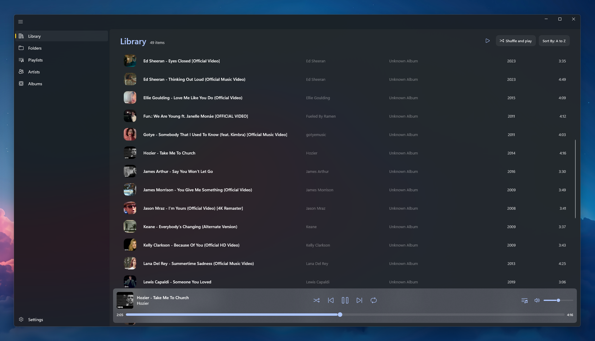
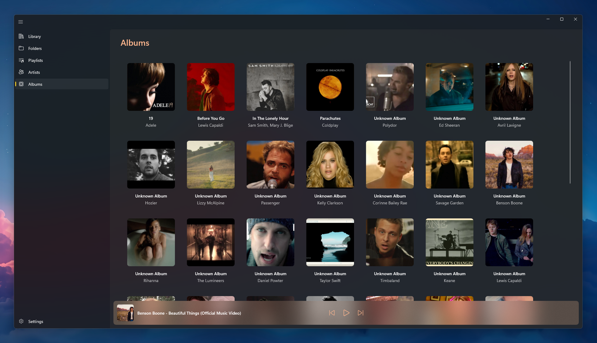
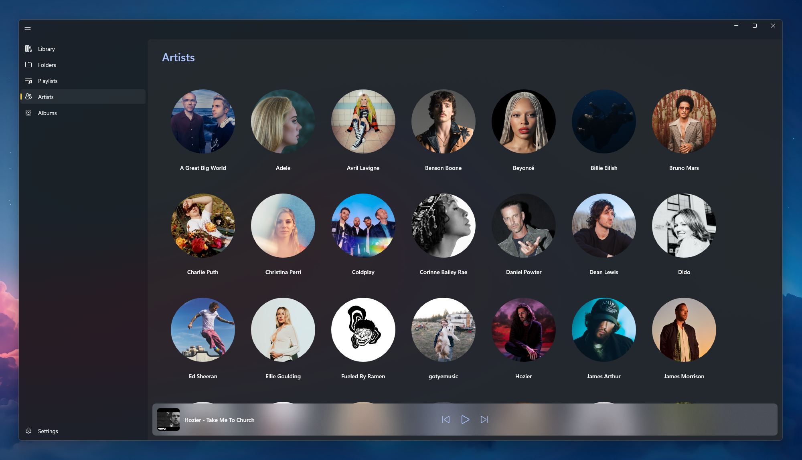
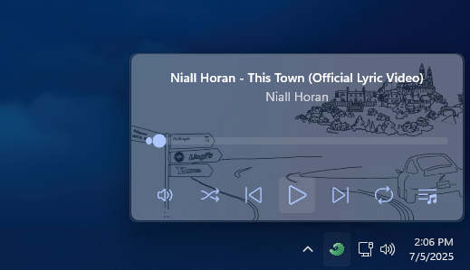

<div align="center">


# Nagi

A fast, private music player for your local library on Windows.

<p>
  <a href="https://github.com/Anthonyy232/Nagi/releases/latest"></a>
  <a href="https://github.com/Anthonyy232/Nagi/releases"></a>
  <a href="https://github.com/Anthonyy232/Nagi/actions/workflows/build.yml"></a>
  <a href="https://crowdin.com/project/nagi"></a>
  <a href="https://github.com/Anthonyy232/Nagi/blob/master/LICENSE"></a>
</p>


</div>

Nagi plays the music already on your computer. Point it at your folders and it builds and maintains the library, plays almost any format through LibVLC, and stays offline unless you turn on an online service. The [privacy policy](PRIVACY.md) lists what each service sends.

## Download

<div align="center">
  <a href="https://apps.microsoft.com/detail/9P1V1PPML3QT?referrer=appbadge&launch=true&mode=full"></a>
  &nbsp;
  <a href="https://github.com/Anthonyy232/Nagi/releases"></a>
</div>

<br>

Windows 10 (1809 or later) or Windows 11, on x64 or ARM64. The Store version updates through the Store; the GitHub release is a signed MSIX bundle that updates itself from GitHub.

## Features

**Library**

- Folder-based library that rescans automatically when files change.
- MP3, FLAC, AAC, OGG, WAV, AIFF, APE, DSD, M4A, WMA, WavPack and more.
- Playlists, rule-based smart playlists, and M3U export.
- Favorites (Ctrl+D), stored in Nagi's database without touching your files.
- Searchable listening history and an Insights page.

**Playback**

- Up Next pane with reordering, shuffle and repeat. Drop files or folders on the player to queue them without importing.
- Listening mixes: **More Variety** spaces out artists and skips recent plays, **Rediscover** picks songs not heard in 30 days, **Unheard** plays songs you've never played.
- **Play for…** builds a queue that fits a chosen duration.
- Sleep timer: after the current song, at the end of the queue, or after a set time.
- 10-band equalizer with preamp, ReplayGain normalization measured locally, and 0.5× to 2× speed without pitch change.

**Lyrics and appearance**

- Lyrics from embedded tags, `.lrc` files, or optional online providers. Click a synced line to seek to it.
- Local romanization for Japanese, Korean and Hindi lyrics via downloadable packs.
- Mica, Mica Alt and Acrylic backdrops, with colors taken from the current album art.
- Resizable always-on-top mini-player.

**Windows integration**

- Tray popup, media keys, system media controls and taskbar thumbnail buttons.
- Jump list entries to shuffle the library or open the mini-player.

**Optional online services** (off by default)

- Last.fm and ListenBrainz scrobbling, with an offline queue.
- Discord Rich Presence.
- Artist and album metadata from Last.fm, MusicBrainz, fanart.tv and TheAudioDB.
- Lyrics from LRCLIB and NetEase.

## Screenshots

<div align="center">
<table>
  <tr>
    <td align="center" colspan="2">
      <br>
      <sub>Library</sub>
    </td>
  </tr>
  <tr>
    <td align="center" width="50%">
      <br>
      <sub>Albums</sub>
    </td>
    <td align="center" width="50%">
      <br>
      <sub>Artists</sub>
    </td>
  </tr>
  <tr>
    <td align="center" colspan="2">
      <br>
      <sub>Tray popup</sub>
    </td>
  </tr>
</table>
</div>

## Build from source

Requirements:

- Visual Studio 2026 (18.0) or later with the **.NET Desktop Development** and **Universal Windows Platform development** workloads.
- .NET 10 SDK 10.0.401 or later (see `global.json`).
- `ffmpeg` on `PATH`, only for the loudness tests and scan benchmarks.

Clone the repository, open `Nagi.sln`, set the platform to `x64` or `ARM64`, and run `Nagi (Package)`.

```bash
git clone https://github.com/Anthonyy232/Nagi.git
```

<details>
<summary>Build an unsigned MSIX bundle</summary>
<br>

From `src/Nagi.WinUI`:

```bash
dotnet publish Nagi.WinUI.csproj -c Release -r win-x64 -p:Platform=x64 -p:PublishReadyToRun=true -p:GenerateAppxPackageOnBuild=false
dotnet publish Nagi.WinUI.csproj -c Release -r win-arm64 -p:Platform=ARM64 -p:PublishReadyToRun=true -p:GenerateAppxPackageOnBuild=false
dotnet msbuild Nagi.WinUI.csproj -p:Configuration=Release -p:Platform=x64 -p:GenerateAppxPackageOnBuild=true -p:AppxBundle=Always "-p:AppxBundlePlatforms=x64|ARM64" -p:AppxPackageSigningEnabled=False
```

GitHub releases are signed through SignPath in CI.

</details>

<details>
<summary>Run the tests</summary>
<br>

```powershell
dotnet test --project tests/Nagi.Core.Tests/Nagi.Core.Tests.csproj -c Release
dotnet test --project tests/Nagi.Presentation.Tests/Nagi.Presentation.Tests.csproj -c Release
dotnet test --project tests/Nagi.WinUI.Tests/Nagi.WinUI.Tests.csproj -c Release -p:Platform=x64
```

The suites use xUnit on Microsoft.Testing.Platform and run on every pull request.

</details>

<details>
<summary>Add a database migration</summary>
<br>

```bash
dotnet ef migrations add <name> --project src\Nagi.Core --startup-project src\Nagi.Core --context MusicDbContext --no-build
```

</details>

## Project structure

| Path | Contents |
| --- | --- |
| `src/Nagi.Core` | Library scanning, database, playback queue, playlists, metadata, lyrics, scrobbling, ReplayGain |
| `src/Nagi.Presentation` | Platform-neutral view models, app services and localized strings |
| `src/Nagi.Audio.LibVlc` | LibVLC audio player |
| `src/Nagi.WinUI` | The Windows app: XAML, windowing, tray, media controls, MSIX packaging |
| `tests/` | Core, Presentation and WinUI test suites |
| `benchmarks/Nagi.Benchmarks` | Scanning and query benchmarks ([README](benchmarks/Nagi.Benchmarks/README.md)) |
| `tools/` | Romanization pack builder and packs |
| `api/NagiAppFunctions` | Azure Functions app that serves third-party API keys so they aren't shipped in the client |

Everything except `Nagi.WinUI` targets plain `net10.0`. See [AGENTS.md](AGENTS.md) for architecture and code conventions.

## Built with

[.NET 10](https://dotnet.microsoft.com/), [WinUI 3](https://learn.microsoft.com/windows/apps/winui/winui3/), [LibVLCSharp](https://github.com/videolan/libvlcsharp), [EF Core](https://learn.microsoft.com/ef/core/) with SQLite, [ATL](https://github.com/Zeugma440/atldotnet), [libebur128](https://github.com/jiixyj/libebur128) ([build notes](src/Nagi.Core/Native/libebur128/README.md)), [ModernLrc](https://github.com/Anthonyy232/ModernLrcParser), [ImageSharp](https://github.com/SixLabors/ImageSharp), [Material Color Utilities](https://github.com/material-foundation/material-color-utilities), [Windows Community Toolkit](https://github.com/CommunityToolkit/Windows), [H.NotifyIcon](https://github.com/HavenDV/H.NotifyIcon), [Serilog](https://serilog.net/) and [XAML Behaviors](https://github.com/Microsoft/XamlBehaviors).

## Contributing

Issues and pull requests are welcome. Translations are handled on [Crowdin](https://crowdin.com/project/nagi) and need no code changes.

If you'd like to support development, you can [sponsor on GitHub](https://github.com/sponsors/Anthonyy232).

## License

[GPL-3.0](LICENSE)
